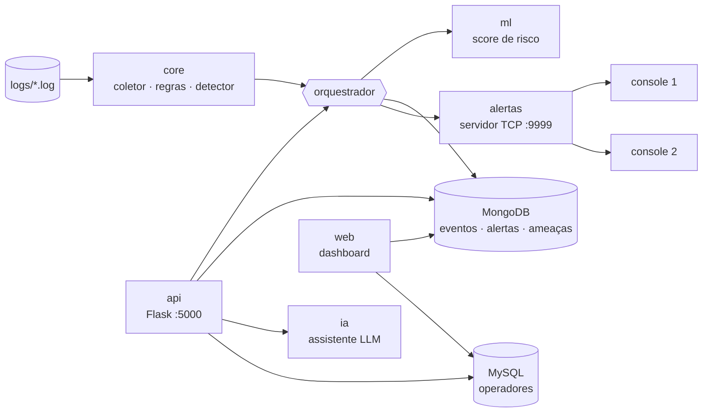

# SecuraPy Platform — Vanguard

SIEM da **CyberShield Ltda.** evoluído do MVP de linha de comando (1º semestre) para uma plataforma em camadas: os eventos e alertas vão para o **MongoDB**, operadores para o **MySQL**, um modelo de **machine learning** prioriza o risco por IP, uma **API REST** e um **dashboard web** expõem os dados, um **assistente LLM** explica eventos em linguagem natural e tudo sobe com **Docker Compose**. Alertas críticos continuam chegando em tempo real nos consoles TCP do 1º semestre.

> Trabalho Final (GS) · Coding for Security · FIAP · 2º semestre

## Integrantes

| Nome | RM | Módulos |
|------|----|---------|
| [Nome completo] | [RM] | A + B — Núcleo e Persistência |
| Victor Cassamassimo da Silva | 572852 | B + E — Persistência e Dashboard/Segurança Web |
| [Nome completo] | [RM] | C — Machine Learning |
| [Nome completo] | [RM] | D + F — API REST e Docker |

---

## Arquitetura



Cada camada só conversa com a de baixo e troca dados nos formatos de [`core/contratos.py`](core/contratos.py) (`Evento`, `Alerta`, `Ameaca`, `Classificacao`, `Triagem`). O `core/` não conhece banco, ML nem web — é o mesmo núcleo do 1º semestre.

```
securaPy_platform/
├── core/                   NÚCLEO (1º sem) ............................ Módulo A
│   ├── coletor.py            leitura e parsing dos 3 logs
│   ├── regras.py             motor de regras (config/regras.json)
│   ├── detector.py           brute force, port scan, blacklist (dict + set)
│   ├── enriquecimento.py     ipinfo.io + cache + backoff em 429
│   ├── relatorios.py         filtros, top IPs, exportação JSON, menu CLI
│   ├── pipeline.py           núcleo em uma chamada: eventos → alertas + ameaças
│   └── contratos.py          formatos de dados compartilhados por todas as camadas
├── alertas/                TEMPO REAL (1º sem) ........................ Módulo A
│   ├── servidor_alertas.py   broadcast TCP (sobe junto com a API no Docker)
│   └── cliente_alertas.py    console do analista
├── db/                     PERSISTÊNCIA ............................... Módulo B
│   ├── mongo_repo.py         eventos/alertas/ameaças, filtros, agregações
│   ├── mysql_repo.py         operadores — queries parametrizadas, senha em hash
│   ├── migracao.py           ingestão inicial dos logs no MongoDB
│   └── schema.sql            tabela usuarios (aplicada pelo compose)
├── ml/                     MACHINE LEARNING ........................... Módulo C
│   ├── features.py           features por IP (treino e classificação usam a mesma)
│   ├── treinar.py            Pipeline + validação cruzada + joblib
│   ├── classificar.py        score de risco por IP (carrega só se o hash conferir)
│   ├── integridade.py        SHA-256 do modelo (OWASP A08)
│   └── anomalias.py          Isolation Forest (bônus)
├── api/                    API REST ................................... Módulo D
│   ├── app.py                rotas, validação, erros e montagem da aplicação
│   └── auth.py               JWT dos operadores + token de serviço
├── web/                    DASHBOARD .................................. Módulo E
│   ├── painel.py             login de operador, painel e investigação de IP
│   ├── seguranca.py          headers de segurança + log de acesso (A09)
│   ├── templates/            Jinja2 (escape automático)
│   └── static/painel.css     CSS externo (a CSP bloqueia inline)
├── ia/assistente.py        LLM com fallback por regras ................ Módulo G
├── scripts/verificar_containers.py   status via Docker SDK ............ Módulo F
├── orquestrador.py         fluxo ponta a ponta (GS §4)
├── main.py                 linha de comando
├── config/                 settings.py (variáveis de ambiente) · regras.json · cache de geolocalização
├── logs/                   auth.log · firewall.log · web_access.log (dados de teste)
├── testes/                 nucleo/ (1º sem) + um arquivo de testes por módulo B–G
├── Dockerfile · docker-compose.yml · .env.example
└── requirements.txt · requirements-dev.txt · pytest.ini
```

---

## Como executar (Docker)

```bash
cp .env.example .env              # troque os valores — o .env nunca vai para o Git
docker compose up --build         # sobe api + mongodb + mysql na rede "securapy"
python scripts/verificar_containers.py   # F2: lista os 3 contêineres como "running"
```

| Serviço | Endereço |
|---------|----------|
| API + dashboard | http://localhost:5000 (saúde: `/api/saude`) |
| Alertas em tempo real | `localhost:9999` |
| MongoDB / MySQL | só em `127.0.0.1` (27017 / 3306) — nunca expostos na rede |

Fluxo da demonstração (GS §4):

```bash
docker compose exec api python main.py operador          # cria o operador do dashboard
docker compose exec api python main.py treinar           # treina o modelo (ou treine antes do build)

python -m alertas.cliente_alertas                        # console 1 (outro terminal, só stdlib)
python -m alertas.cliente_alertas                        # console 2

curl -X POST http://localhost:5000/api/token -H "Content-Type: application/json" \
     -d '{"email": "<email do operador>", "senha": "<senha>"}'   # login → JWT válido por 30 min

curl -X POST http://localhost:5000/api/analisar \
     -H "Authorization: Bearer <JWT recebido>" \
     -H "Content-Type: application/json" -d "{}"         # analisa os 3 logs → alertas chegam nos consoles

curl http://localhost:5000/api/ip/185.220.101.1          # eventos + alertas + geo + score + triagem
```

No PowerShell, use `curl.exe` no lugar de `curl`. Depois: `http://localhost:5000/login` → painel → busca por IP.

### Autenticação da API

As rotas de escrita (`POST /api/alertas` e `POST /api/analisar`) exigem `Authorization: Bearer <token>`. São aceitos dois tipos:

| Token | Para quem | Como obter |
|-------|-----------|------------|
| **JWT** (HS256) | operadores | `POST /api/token` com email e senha do MySQL — expira em `JWT_EXPIRA_MINUTOS` (padrão 30) |
| **Token de serviço** | automações e scripts | `API_TOKEN` do `.env` — deixe vazio para aceitar só JWT |

O JWT é recusado se estiver expirado, adulterado, assinado com outra chave ou sem assinatura (`alg: none`). Alertas criados pela API guardam quem os criou em `criado_por`.

### Sem Docker (desenvolvimento)

```bash
python -m venv .venv && .venv\Scripts\activate           # Linux/Mac: source .venv/bin/activate
pip install -r requirements-dev.txt
python main.py analisar --sem-banco                      # roda já hoje: núcleo + relatório JSON
python main.py api                                       # API + dashboard em http://localhost:5000
python main.py menu                                      # menu interativo do 1º semestre
```

Com os bancos do compose no ar, o `.env` local faz `python main.py ingerir` gravar direto neles.

---

## Testes

```bash
python -m pytest                       # tudo
python -m pytest -m nucleo             # só o 1º semestre
python -m pytest -m persistencia       # um módulo: persistencia | ml | api | web | docker | llm
python -m pytest --tb=no -q            # placar rápido
```

Cada cenário da GS virou teste (`test_b_*` … `test_g_*`) — o mesmo esquema do 1º semestre: **o teste falha até o módulo ser implementado**. Banco, rede, Docker e OpenAI são simulados (mongomock, MagicMock, LLM falso), então tudo roda offline e sem gastar créditos.

Placar no ponto de partida:

```
198 passed · 65 failed · 18 errors · 2 skipped
```

Os 198 são os 197 testes do núcleo + `/api/saude`. As falhas e erros são `NotImplementedError` e respostas `501` dos módulos B–G — somem conforme a equipe implementa. Os 2 pulados (F1/F3) rodam com a plataforma no ar: `SECURAPY_E2E=1 python -m pytest -m docker`.

---

## Mapa de implementação

Cada função pendente tem docstring curta com o contrato e o cenário da GS entre colchetes (ex.: `[B2]`). Rotas pendentes respondem `501` com o cenário; o `orquestrador` marca etapas pendentes sem derrubar a análise.

| Ordem | Módulo | Arquivos | Cenários | Testes |
|:-----:|--------|----------|----------|--------|
| 1 | **B** Persistência | `db/mongo_repo.py`, `db/mysql_repo.py`, `db/migracao.py` | B1–B4 | `test_b_persistencia.py` |
| 1 | **C** Machine Learning | `ml/features.py`, `ml/integridade.py`, `ml/treinar.py`, `ml/classificar.py` | C1–C4 | `test_c_ml.py` |
| 2 | **D** API REST | `api/auth.py`, `api/app.py` (rotas + `registrar_erros`) | D1–D5 | `test_d_api.py` |
| 2 | **E** Web | `web/seguranca.py`, `web/painel.py` | E1–E4 | `test_e_web.py` |
| 2 | **G** LLM | `ia/assistente.py` | G1–G4 | `test_g_assistente.py` |
| 3 | **F** Docker | `scripts/verificar_containers.py` (Dockerfile e compose prontos) | F1–F3 | `test_f_docker.py` |

B e C não dependem um do outro e começam juntos. D e E usam o banco, então vêm depois de B (GS §8, dica 3).

### Convenções da equipe

- Importe módulos, não funções: `from db import mongo_repo` → `mongo_repo.buscar_alertas(...)`. Os testes substituem funções no módulo.
- Configuração sempre por `settings.X` (`from config import settings`) — nunca valor fixo no código, nunca segredo no Git.
- Queries MySQL só com `%s`; templates sem `|safe`; `debug=True` nunca.
- Mudou um formato em `core/contratos.py`? Avise o grupo antes do commit.

---

## O que veio do 1º semestre

| 1º semestre | Agora | O que mudou |
|-------------|-------|-------------|
| `coletor.py` | `core/coletor.py` | mesmo parsing; dispatch por dicionário de parsers |
| `regras.py` | `core/regras.py` | mesma lógica; código duplicado removido |
| `detector.py` | `core/detector.py` | mesma lógica (dict + set) |
| `enriquecimento.py` | `core/enriquecimento.py` | **corrigido** (`eh_ip_privado` aceitava só objeto, `consultar_ip` retornava `None`); cache em dict, backoff em 429 (Aula 10) |
| `relatorios.py` | `core/relatorios.py` | exporta ameaças (sets → listas) para o relatório JSON |
| `servidor_alertas.py` / `cliente_alertas.py` | `alertas/` | porta por variável de ambiente; servidor sobe em thread junto da API |
| `main.py` (menu) | `python main.py menu` | o menu continua disponível como subcomando |
| `testes/` (197) | `testes/nucleo/` | **197/197 passando** (antes da reorganização: 176) |

Observação sobre o cenário A2: o `auth.log` tem **11** FAILs de `185.220.101.1` (a GS cita 10); a severidade esperada, ALTA, confere.

---

## Divisão de tarefas

### [Nome — Pessoa A] · Módulos A e B
- **O que fez:**
- **Dificuldades:**

### Cassa · Módulos B e E
- **O que fez:** Integração dos bancos de dados e "assinatura" das tabelas de persistência. Criação do Dashboard e aplicação de medidas de segurança para a plataforma WEB dos operadores.
- **Dificuldades:** Não tenho costume de fazer vibe coding, portanto, ainda tenho dificuldades de realizar atividades com prompts adequados. A longo prazo, a revisão dos condigos tornou-se mais facil, porém, ter o controle do que faço dessa forma é  mais complicados, diferente da primeira GS, que, ao menos, toda a lógica e parte fundamental do funcionamento do enriquecimento com consultas a API foram feitas por mim, e apenas aprimoradas com o uso de IA.

### [Nome — Pessoa B] · Módulo C
- **O que fez:**
- **Dificuldades:**

### [Nome — Pessoa C] · Módulos D e F
- **O que fez:**
- **Dificuldades:**

---

## Entregáveis

- [ ] Código-fonte com Dockerfile e docker-compose
- [ ] README preenchido (integrantes e divisão de tarefas)
- [ ] Vídeo (12–18 min): compose → análise via API → dashboard → busca de IP → score → LLM → 2 consoles
- [ ] `saida/relatorio_exemplo.json` — `python main.py analisar --saida saida/relatorio_exemplo.json`
- [ ] `ml/modelo.pkl` + `ml/modelo.sha256` + `ml/metricas.json` — `python main.py treinar`

## Bônus

| Bônus | Onde | Situação |
|-------|------|:--------:|
| Detecção de anomalias (+0,30) | `ml/anomalias.py` — `python -m ml.anomalias` | ✅ |
| Correlação temporal (+0,20) | `core/detector.py` — brute force por janela de tempo | ⏳ |
| Testes automatizados (+0,30) | `testes/` — `python -m pytest` | ✅ |
| JWT completo (+0,20) | `api/auth.py` — `python -m pytest -m jwt` | ✅ |
